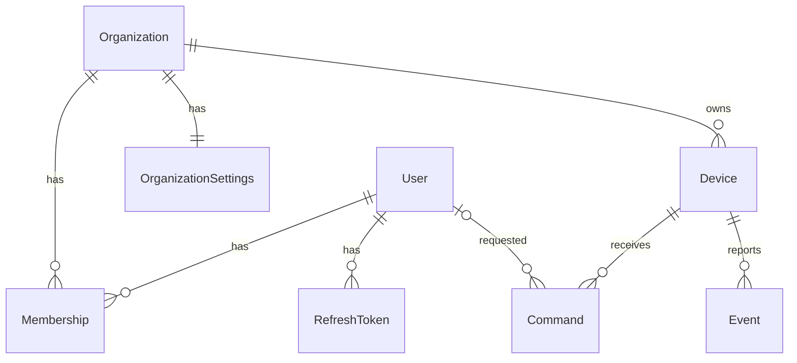

# Multi-tenant core

Status: implemented (backend and dashboard). Not yet applied to the production database.

Where the implementation differs from the plan below:

- Annotations are accepted only from a socket currently watching that device's live view, instead of re-checking membership on every stroke; viewers' access is re-checked every 30 seconds and when their token expires.
- Dashboard sockets re-check memberships periodically (and on demand), so removed members lose an organization's realtime data without reconnecting.
- A device's online state comes from live agent sockets (`realtime/presence.ts`), not the stored `isOnline` column, which is kept only as a last-known record.

## Goal

Turn Sentinel from "one admin, one laptop" into "many organizations, each with its own members and devices", with a hard guarantee that nothing in one organization is visible to, or controllable from, another. The Rust agent's wire protocol does not change.

## Today's single-tenant assumptions

| Where | Assumption |
| --- | --- |
| `schema.prisma` | `User` and `Settings` are singletons; `Device`, `Event`, `Command` have no owner |
| `deviceRepository.findFirst()` | Used by commands, files, metrics, processes, screenshots, stream and `/device/status` to pick "the" device |
| `realtime/socket.ts` | Every broadcast goes to the whole `/dashboard` namespace; frames go to one global `live-viewers` room |
| `stream.service.ts` | One module-level `state` for the only live view |
| Pending-request maps | Matched by `requestId` only, not by the device that was asked |
| `settingsRepository`, `telegramService` | One Telegram config for the whole instance |
| Routes | `/api/device/*` has no device or org in the path |

## 1. Data model



### New

```prisma
enum OrgRole {
  OWNER
  ADMIN
  VIEWER
}

model Organization {
  id        String   @id @default(uuid())
  name      String
  slug      String   @unique
  createdAt DateTime @default(now())
  updatedAt DateTime @updatedAt

  memberships Membership[]
  devices     Device[]
  settings    OrganizationSettings?

  @@map("organizations")
}

model Membership {
  id        String       @id @default(uuid())
  userId    String
  user      User         @relation(fields: [userId], references: [id], onDelete: Cascade)
  orgId     String
  org       Organization @relation(fields: [orgId], references: [id], onDelete: Cascade)
  role      OrgRole
  createdAt DateTime     @default(now())

  @@unique([userId, orgId])
  @@index([orgId])
  @@map("memberships")
}

model OrganizationSettings {
  id               String       @id @default(uuid())
  orgId            String       @unique
  org              Organization @relation(fields: [orgId], references: [id], onDelete: Cascade)
  telegramBotToken String?
  telegramChatId   String?
  updatedAt        DateTime     @updatedAt

  @@map("organization_settings")
}
```

### Changed

```prisma
model User {
  // existing fields unchanged, plus:
  name              String?
  memberships       Membership[]
  requestedCommands Command[]
}

model Device {
  // existing fields unchanged, plus:
  orgId String
  org   Organization @relation(fields: [orgId], references: [id], onDelete: Cascade)

  @@unique([id, orgId])   // target of the composite foreign keys below
  @@index([orgId])
}

model Event {
  // existing fields unchanged, plus:
  orgId  String
  device Device @relation(fields: [deviceId, orgId], references: [id, orgId], onDelete: Cascade)

  @@index([orgId, occurredAt])
}

model Command {
  // existing fields unchanged, plus:
  orgId         String
  device        Device  @relation(fields: [deviceId, orgId], references: [id, orgId], onDelete: Cascade)
  requestedById String?
  requestedBy   User?   @relation(fields: [requestedById], references: [id], onDelete: SetNull)

  @@index([orgId, requestedAt])
}
```

`Settings` is replaced by `OrganizationSettings` and dropped.

### Reasoning

- **`orgId` is copied onto `Event` and `Command`**, not only reachable through `Device`. Every list query then filters on an indexed column of the table it reads (`orgId, occurredAt`), and a missed join can't silently widen a query.
- **Composite foreign keys `(deviceId, orgId) -> Device(id, orgId)`** make the copy safe: Postgres itself rejects an event or command whose `orgId` doesn't match its device's org. The duplication can't drift.
- **Three roles, not four.** OWNER, ADMIN and VIEWER cover every real case here; a separate MEMBER role would sit between two others without a distinct permission set.
- **`requestedById` is nullable** because existing command history has no recorded requester, and deleting a user shouldn't delete the audit trail of what they did.
- **Users can belong to several organizations.** It costs nothing extra in the schema and is what makes an org switcher (and a believable SaaS demo) possible.

## 2. API shape

The organization (and device, where relevant) is part of the URL:

```
GET    /api/orgs                                   my organizations, with my role in each
GET    /api/orgs/:orgId
GET    /api/orgs/:orgId/members

GET    /api/orgs/:orgId/devices                    list, with online status
POST   /api/orgs/:orgId/devices                    create a device, returns its token once
GET    /api/orgs/:orgId/devices/:deviceId          replaces /api/device/status

POST   /api/orgs/:orgId/devices/:deviceId/commands
GET    /api/orgs/:orgId/devices/:deviceId/commands  command history (new)
GET    /api/orgs/:orgId/devices/:deviceId/processes
GET    /api/orgs/:orgId/devices/:deviceId/files
GET    /api/orgs/:orgId/devices/:deviceId/files/download
GET    /api/orgs/:orgId/devices/:deviceId/metrics
POST   /api/orgs/:orgId/devices/:deviceId/screenshot

GET    /api/orgs/:orgId/events?deviceId=&type=&page=
GET    /api/orgs/:orgId/settings/integrations
POST   /api/orgs/:orgId/settings/integrations/telegram
DELETE /api/orgs/:orgId/settings/integrations/telegram
```

`/api/auth/*` and `/health` are unchanged. The old `/api/device/*`, `/api/events` and `/api/settings/*` routes are removed in the same change as the frontend update, so there is no period where both exist.

**Why the org goes in the path** rather than in a header or the JWT: it is visible in logs and the browser, needs no hidden client state, works for links ("open this device"), and makes switching orgs a navigation instead of a token reissue.

### Request pipeline

```
authGuard -> orgContext -> requirePermission(action) -> deviceContext -> controller -> service
```

- **`orgContext`** loads the caller's `Membership` for `:orgId` (one indexed lookup) and attaches `req.org = { id, role }`. If the caller isn't a member, it returns **404**, the same as for an org that doesn't exist, so org ids can't be probed.
- **`requirePermission(action)`** checks `req.org.role` against the permission table. A member without the role gets **403**.
- **`deviceContext`** loads `:deviceId` with `where: { id, orgId }` and attaches `req.device`. A device in another org is a **404**.
- **Services take an explicit context** (`{ orgId, deviceId }`) instead of discovering the device themselves. `deviceRepository.findFirst()` is deleted, so the old pattern can't creep back.
- **The role is read from the database on every request**, not baked into the JWT, so removing someone or downgrading their role takes effect immediately rather than after the 15-minute token lifetime.

## 3. Permissions

| Action | VIEWER | ADMIN | OWNER |
| --- | :-: | :-: | :-: |
| See devices, status, metrics, events, command history | yes | yes | yes |
| See the process list | yes | yes | yes |
| See members | yes | yes | yes |
| Browse and download files | no | yes | yes |
| Screenshot, live view, annotations | no | yes | yes |
| Send commands (lock, restart, shutdown, sleep, log off, kill process) | no | yes | yes |
| Add a device | no | yes | yes |
| Change integrations (Telegram) | no | yes | yes |
| Manage members, rename or delete the org | no | no | yes (endpoints come with invites, in the accounts module) |

Defined once in `backend/src/common/permissions.ts` as a map from an action name to the lowest role allowed, with a role ranking (`VIEWER < ADMIN < OWNER`). Routes and socket handlers both call the same `can(role, action)` function, so the REST API and realtime can't disagree. File access and screen viewing sit with commands at ADMIN because they expose the device owner's private data, not just its state.

## 4. Realtime

### Rooms

| Room | Who joins | What is sent there |
| --- | --- | --- |
| `org:{orgId}` | Dashboard sockets of every member of that org | `event:new`, `device:status`, `command:update`, `stream:state` |
| `stream:{deviceId}` | Dashboard sockets actively watching that device's live view | `stream:frame` |
| `device:{deviceId}` | That device's agent socket | Requests to the agent (`command:execute`, `metrics:request`, and so on) |

Room names come from one helper module (`realtime/rooms.ts`) so they are never spelled by hand.

### Dashboard namespace

- **On connect**, after the JWT check, the server loads the user's memberships and joins one `org:` room per org. A user added to a new org sees it after their socket reconnects (a page refresh). Live re-sync on membership changes belongs with the session work in the accounts module.
- **`stream:start`, `stream:stop`, `annotation:update`, `annotation:clear`** now carry `{ orgId, deviceId }`. Each handler re-checks the membership, the permission and that the device belongs to that org before acting, exactly like the REST pipeline, through a shared `authorizeDeviceAction()` helper.
- **Every payload sent to dashboards includes `deviceId`** (most already do), so the frontend can route updates to the right device view.

### Agent namespace

- Device-token authentication is unchanged. The device row now carries its `orgId`, which the socket stores as `socket.data = { deviceId, orgId }`.
- On connect the agent socket joins `device:{deviceId}`. `findAgentSocket(deviceId)` looks in that room instead of scanning every connected socket with `fetchSockets()`.
- Status changes and events are broadcast to `org:{device.orgId}` only.

### Live view

`stream.service.ts` keeps a `Map<deviceId, StreamState>` instead of one global `state`. Each device has its own session id, viewer set and frame relay; frames from an agent are checked against that device's session and forwarded only to `stream:{deviceId}`. Stopping the last viewer of one device leaves other devices' streams untouched, and an agent disconnect ends only its own device's stream.

### Pending requests bound to a device

Every pending entry in the metrics, process, file, screenshot and command services records the `deviceId` it was sent to. A response is accepted only when it arrives on that same device's agent socket:

```ts
resolveResponse(fromDeviceId, requestId, payload) // ignored unless pending.deviceId === fromDeviceId
```

Today any connected agent that knew a request id could answer it. Request ids are random UUIDs, so this is defense in depth rather than an open hole, but with several customers' agents on one server it is the kind of guarantee an isolation boundary should enforce.

Download concurrency becomes a per-device limit (5) under a global limit (20), so one busy device can't block everyone else's downloads.

### Still single-instance

All of this state stays in process memory, as today. That is fine for a portfolio deployment on one Render instance. Moving it to Redis (Socket.IO adapter, shared pending-request store) is a later module and doesn't change the room design above.

## 5. Telegram

`telegramService.sendMessage(orgId, text)` reads that org's `OrganizationSettings`. Events from a device notify only its own organization's chat. The settings endpoints read and write the row for `:orgId`.

## 6. Migrating your existing data

One Prisma migration, hand-edited so the data move happens inside the same transaction as the schema change:

1. Create `OrgRole`, `organizations`, `memberships` and `organization_settings`.
2. If any user exists, insert one organization named **"Personal"** (slug `personal`) and give **every existing user an OWNER membership** in it. Today that is just your admin account.
3. Add `orgId` to `devices`, `events` and `commands` as nullable, set it to the Personal org's id, then make it `NOT NULL` and add the indexes, the `(id, orgId)` unique key and the composite foreign keys.
4. Copy the Telegram token and chat id from the `settings` row into `organization_settings` for the Personal org, then drop `settings`.
5. Add `commands.requestedById` as nullable. Existing history keeps `NULL`.

On an empty database (fresh clone, CI, tests) steps 2 to 4 simply move zero rows.

**What doesn't change for you:** your login, your laptop's device token, the installed Windows service and its `agent.toml`, your event and command history, and your Telegram alerts. The agent reconnects exactly as before and lands in the Personal org.

**Before applying it to Neon:** create a Neon branch of the production database (free, takes seconds) as a restore point, run `prisma migrate deploy` against the branch first, check it, then run it against main.

`prisma/seed.ts` is updated to create the admin user, the Personal org, the OWNER membership and the first device inside that org, so a fresh clone still works with `npm run seed`.

## 7. Frontend changes

- **Routes become org- and device-scoped:** `/o/:orgId` (dashboard), `/o/:orgId/devices`, `/o/:orgId/devices/:deviceId` (with its Overview, Processes, Files tabs), `/o/:orgId/events`, `/o/:orgId/settings`. Visiting `/` sends you to your first org.
- **`OrgProvider`** loads `GET /api/orgs`, exposes the current org and your role, and drives an org switcher in the sidebar (hidden when you're in only one org).
- **New devices list page**, the natural landing view once there can be more than one device, with an "Add device" flow that shows the token once.
- **API client functions take `orgId` / `deviceId`**, and TanStack Query keys include them so caches never mix devices.
- **Socket handlers filter by `deviceId`**, and the live viewer sends `{ orgId, deviceId }` with `stream:start`.
- **Controls are hidden or disabled by role** (a VIEWER doesn't see command buttons, file downloads or the live view). This is for UX only; the backend is the enforcement point.

## 8. Testing

Integration tests run against a real Postgres (your local Docker Postgres, or a disposable Neon branch in CI), not mocks, because the composite keys and scoped queries are exactly what needs proving.

**Tenant isolation suite** (`backend/src/test/integration/tenantIsolation.test.ts`): two orgs, A and B, each with a user and a device.

- REST: user A gets **404** for org B, for org B's device, and for each of its sub-routes (commands, files, metrics, screenshot, processes).
- REST: user A's event list and command history contain nothing from org B, including with `?deviceId=` set to B's device.
- Database: inserting an event with device B's id and org A's id is rejected by the foreign key.
- Sockets: a dashboard in org A receives no `event:new`, `device:status`, `command:update` or `stream:state` from org B.
- Sockets: `stream:start` for B's device from A's dashboard is refused, and no frame from B's agent ever reaches A.
- Agents: a response sent by agent B with the request id of a request made to agent A is ignored.

**Permission suite:** a VIEWER gets **403** on commands, files, screenshots, live view and settings changes, and **200** on the read routes. The `can()` table gets its own unit tests.

**Migration test:** apply all migrations up to today's schema, insert a user, a device, events, commands and a settings row, apply the new migration, and assert everything lands in the Personal org with the user as OWNER and the Telegram config intact.

New dev dependencies: `supertest` (HTTP assertions) and `socket.io-client` (socket assertions). A separate `vitest.integration.config.ts` and an `npm run test:integration` script keep the existing fast unit tests independent of a database.

## 9. File structure

```
backend/
  prisma/
    schema.prisma                                      changed
    migrations/<timestamp>_multi_tenant_core/
      migration.sql                                    new, hand-edited data move
    seed.ts                                            changed
  src/
    common/
      permissions.ts                                   new: roles, actions, can()
    middleware/
      orgContext.ts                                    new: membership lookup, 404 for non-members
      requirePermission.ts                             new
      deviceContext.ts                                 new: device scoped to org
    modules/
      organization/                                    new module
        organization.routes.ts
        organization.controller.ts
        organization.service.ts
        organization.repository.ts                     orgs and memberships
        organization.types.ts
        organization.validation.ts
      device/
        device.routes.ts                               becomes the nested /devices router
        device.repository.ts                           findInOrg, listForOrg; findFirst removed
        device.controller.ts / device.service.ts       list, get, create
      command/ event/ file/ metrics/ process/
      screenshot/ stream/ settings/ telegram/          take { orgId, deviceId }; pending maps bound to deviceId
    realtime/
      rooms.ts                                         new: room-name helpers
      socket.ts                                        org- and device-scoped emitters
      namespaces/agentNamespace.ts                     joins device room, passes deviceId to resolvers
      namespaces/dashboardNamespace.ts                 joins org rooms, authorizes stream and annotation
      authorizeDeviceAction.ts                         new: shared socket permission check
    types/express.d.ts                                 req.org, req.device
    app.ts                                             mounts /api/orgs
    test/integration/
      helpers.ts                                       new: factories, test server, socket clients
      tenantIsolation.test.ts                          new
      permissions.test.ts                              new
      migration.test.ts                                new
  vitest.integration.config.ts                         new

frontend/src/
  features/org/                                        new: OrgProvider, useOrg, OrgSwitcher
  features/devices/                                    new: DevicesPage, AddDeviceDialog
  api/*.api.ts                                         take orgId / deviceId
  realtime/SocketProvider.tsx                          filter by deviceId
  App.tsx                                              /o/:orgId/... routes

agent/                                                 unchanged
```

## 10. Out of scope here

These come in later modules and are intentionally not part of this one: sign-up, email verification and invites; cookie-based sessions and socket re-auth; device pairing codes and token revocation; the audit log table; Redis; billing; the landing page and demo mode.

## 11. Build order inside this module

1. Schema, migration, seed, and the migration test.
2. Permissions, the three middlewares and the organization module.
3. Move every service and route to `{ orgId, deviceId }`; delete `findFirst()`.
4. Realtime rooms, per-device stream state, device-bound pending requests.
5. Tenant isolation and permission suites green.
6. Frontend routes, org context, devices page and role-aware controls.
7. Apply to a Neon branch, verify with your real laptop agent, then apply to production.

Each step compiles and its tests pass before the next starts.
